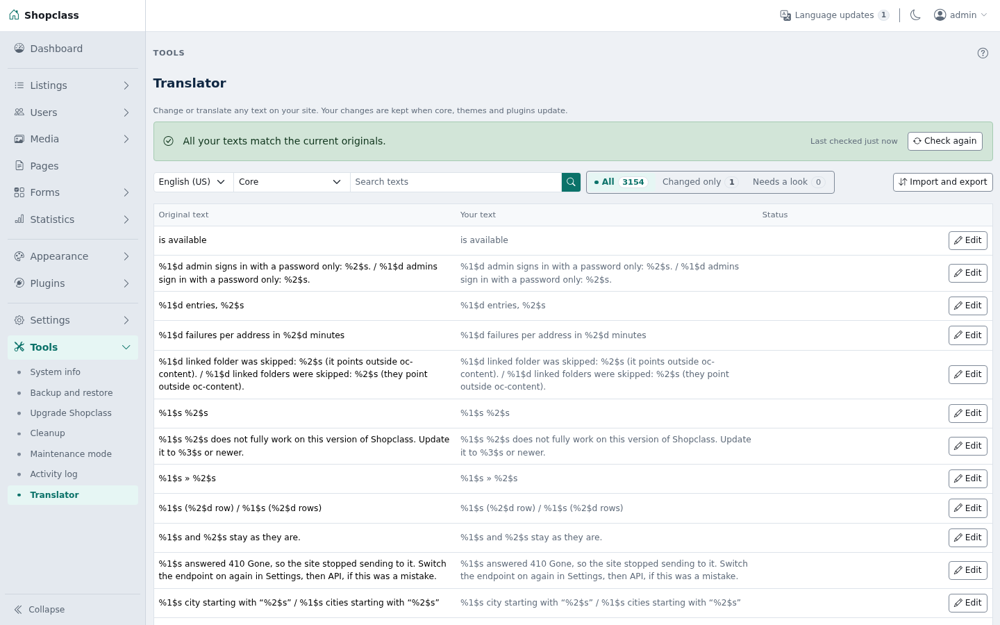

# Translator

Change or translate any text on your site: the admin, the theme and plugins. Your changes are kept per language, and they survive core, theme and plugin updates.

Your texts are saved in `oc-content/plugin-data/translator/`. They stay through updates. Uninstalling the plugin keeps them too. Delete that folder to remove them.

## Requirements

- Shopclass 7.0.6 or later
- PHP 8.0 or later

## Install

1. Open Plugins → Browse (or upload the zip from the GitHub release).
2. Install.
3. Activate.

## Use

Open Tools → Translator.

1. Pick a language and a source: Shopclass itself, the messages, your theme, or a plugin.
2. Search for the text. Click Edit, type your text, save.
3. Reset to original removes your change for that text.

Saving checks your text. Placeholders such as `%s` and `%1$s` must stay, and so must HTML tags. The page cache is cleared on save, so the new text shows at once.

A theme or plugin that ships no translation template shows a Make a template button. It reads the texts from its PHP files. Rebuild the template in Import and export after the theme or plugin updates.

E-mail templates, categories and pages are content. They keep their own screens.

## Upload and download

These are in the Import and export drawer, opened from the button above the list.

- Download my changes gives a `.po` file with your changed texts only.
- Export full translation gives a `.po` with the shipped translation and your changes together, for the chosen language and source.
- Export all as .zip gives one full `.po` per source for the chosen language. The button shows only when PHP has the zip extension.
- Upload takes a `.po` file. Choose Add to my changes (your other changes stay) or Replace all my changes.
- Undo last upload brings back the file as it was before the last upload or Remove all. One backup is kept per language and source.
- Remove all my changes clears every change for that language and source. Undo brings them back.

## When a new version changes a text

After an update, the sync check compares your changes with the new originals. Texts that were removed or changed are flagged. For each one you can Keep mine, Use the new original, or Remove mine.

## Notes / limits

- Uninstall drops the sync check cache only. Your texts stay in `oc-content/plugin-data/translator/`.
- Keep that folder in your backups.
- Apache sites are closed to direct reads of that folder by an `.htaccess` file. The Docker image of Shopclass 7.0.x serves `oc-content/plugin-data/` until core 7.1. The files hold only translations.
- Works on shared hosting. No cron, no worker, no shell.

## For developers

Run the tests with `./tests/run.sh`. They need no database or network. Point `SHOPCLASS_CORE` at a Shopclass core checkout (default `../shopclass`).

To ship a `.po` with a site by hand, put it at `oc-content/plugin-data/translator/<locale>/<source>.po`. The source is `core`, `messages`, `theme-<slug>` or `plugin-<slug>`, for example `hi_IN/theme-storefront.po`. The `.mo` is built when a text is saved from the screen.

## Support

https://github.com/mindstellar/shopclass-plugin-translator/issues

## License

GPL-3.0-or-later
